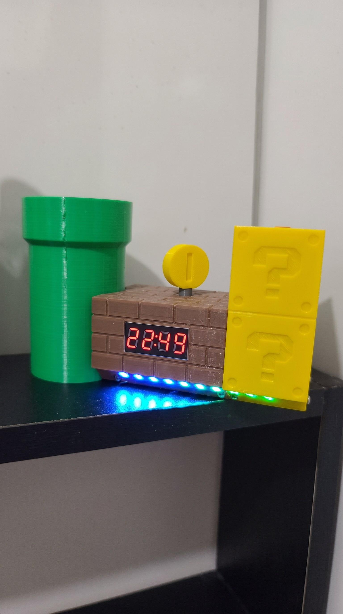
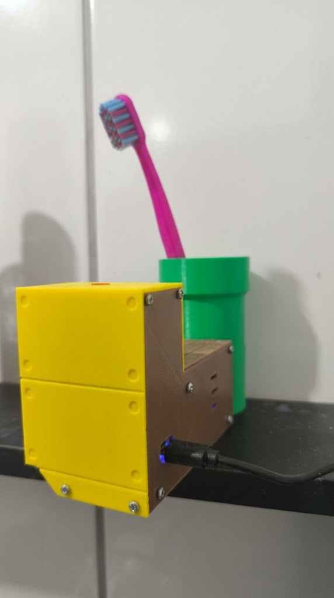

<div align="center">

# 🪥 Porta-Escova Inteligente

### Relógio, alarme e temporizador de escovação com ESP8266, LEDs RGB e Home Assistant

**Um projeto de automação residencial que transforma um porta-escova em um dispositivo interativo:** detecta a retirada da escova, acompanha o tempo de uso e oferece lembretes luminosos e sonoros.


**[Funcionalidades](#-funcionalidades) · [Componentes](#-componentes-utilizados) · [Ligações](#-mapeamento-dos-pinos) · [Fotos](#-galeria-do-projeto)**

</div>

---

## 📖 Sobre o projeto

O **Porta-Escova Inteligente** utiliza uma placa **NodeMCU ESP8266**, programada com **ESPHome**, para monitorar a presença de uma escova de dentes e oferecer recursos de relógio, alarme e cronômetro.

Um sensor infravermelho identifica quando a escova é retirada ou devolvida ao suporte. O dispositivo também conta com **display de quatro dígitos TM1637**, **10 LEDs RGB endereçáveis**, **buzzer** e uma interface de navegação com **encoder rotativo** e botão de retorno.

A integração com o **Home Assistant** permite acompanhar informações e controlar recursos do dispositivo pela automação residencial.

> **Sobre esta documentação:** as funcionalidades e os pinos descritos abaixo foram identificados na configuração ESPHome do projeto. Fotos, esquema elétrico e detalhes mecânicos ainda serão adicionados. As conexões devem ser conferidas no hardware antes da montagem.

## ✨ Funcionalidades

| Recurso | Como funciona |
| --- | --- |
| 🪥 Detecção da escova | Sensor IR conectado à entrada analógica detecta a presença/ausência da escova. |
| ⏱️ Medição de uso | Conta o intervalo entre retirar e devolver a escova. Registra sessões superiores a 5 segundos. |
| 📊 Histórico no Home Assistant | Publica a duração da última utilização, em segundos, na entidade **Tempo de Escovação**. |
| 🌈 Iluminação RGB | Acende os LEDs com efeito arco-íris ao retirar a escova, quando o dispositivo está ocioso. |
| 🕒 Relógio digital | Exibe a hora recebida do Home Assistant no display TM1637. |
| ⏰ Alarme configurável | Permite definir horário, ativação, som e efeito luminoso. |
| ⌛ Temporizador | Contagem regressiva ajustável de **1 a 5 minutos**, em passos de 30 segundos. |
| 🔊 Avisos sonoros | Melodias e sinais sonoros por buzzer usando RTTTL. |
| 🎛️ Controle local | Navegação e ajustes por encoder rotativo com botão, além de botão de sair/iniciar timer. |
| 🌙 Modo noturno | Brilho reduzido automaticamente entre **22h e 6h**, ou modo configurado manualmente. |
| 🌡️ Painel Home Assistant | Alterna a exibição de temperatura e umidade de sensores externos integrados ao HA. |
| 📶 Rede e manutenção | Suporte a duas redes Wi-Fi, ponto de acesso de recuperação, interface web e atualização OTA. |

### Como é registrada uma escovação

1. A escova é **retirada**: o dispositivo registra o início e pode acender a iluminação RGB.
2. A escova é **devolvida**: o tempo decorrido é calculado.
3. Se o uso durou **mais de 5 segundos**, o tempo é enviado ao Home Assistant.
4. O display mostra a duração em **minutos e segundos** por aproximadamente **3 segundos**.

> O sensor mede o **tempo de retirada da escova do suporte**, não a qualidade da escovação. É uma estimativa de uso, e não uma avaliação odontológica.

## 🧩 Componentes utilizados

| Componente | Função |
| --- | --- |
| **NodeMCU ESP8266** (`nodemcuv2`) | Microcontrolador e conectividade Wi-Fi |
| **Display TM1637, 4 dígitos** | Exibição de horas, menus, timer e feedback |
| **10 LEDs RGB endereçáveis** (configurados como WS2811) | Efeitos e sinalizações visuais |
| **Sensor infravermelho com saída analógica** | Detecção da presença da escova |
| **Encoder rotativo com botão** | Navegação, seleção e edição das configurações |
| **Botão adicional** | Sair dos menus e iniciar/parar o temporizador |
| **Buzzer acionado por PWM** | Melodias e avisos sonoros |
| **LED de status** | Indicador visual de conectividade |
| **Fonte e conexões adequadas** | Alimentação dos módulos |

**Atenção:** os modelos exatos do sensor, do buzzer e da fonte devem ser confirmados no hardware. O firmware, por si só, não documenta suas especificações elétricas.

## 🔌 Mapeamento dos pinos

O mapeamento abaixo foi extraído da configuração ESPHome fornecida.

| Pino NodeMCU | Componente | Uso no firmware |
| --- | --- | --- |
| `D0` | LED de status | Saída digital |
| `D1` | TM1637 | Clock (`CLK`) |
| `D2` | TM1637 | Dados (`DIO`) |
| `D3` | Botão Sair | Entrada com pull-up interno |
| `D4` | LEDs RGB | Dados da fita/cadeia de LEDs |
| `D5` | Encoder | Canal A |
| `D6` | Encoder | Canal B |
| `D7` | Encoder | Botão de pressão |
| `D8` | Buzzer | Saída PWM |
| `A0` | Sensor IR | Leitura analógica |

> ⚠️ **Importante:** alguns GPIOs do ESP8266 interferem na inicialização conforme o nível lógico presente no boot (especialmente os associados a `D3`, `D4` e `D8`). Confirme níveis elétricos, alimentação, resistores e o circuito antes de energizar. **Não conecte uma saída de 5 V diretamente ao pino A0.** Confira também o limite de tensão de entrada analógica da sua versão de NodeMCU.

## 🎛️ Controles e menus

### Botões físicos

| Ação | Resultado |
| --- | --- |
| Girar o encoder | Navega pelos menus ou altera um valor |
| Clique curto no encoder, fora do menu | Mostra temporariamente o horário do alarme; LED verde se ativo ou vermelho se desativado |
| Clique curto no encoder, dentro do menu | Entra na opção, avança a edição ou salva |
| Pressionar o encoder por cerca de 2 segundos ou mais | Abre o menu principal quando o dispositivo está ocioso |
| Botão **Sair**, dentro do menu | Volta para a tela principal |
| Botão **Sair**, fora do menu | Inicia ou interrompe o temporizador |

### Organização do menu

```text
MENU PRINCIPAL
├── ALAr  (Alarme)
│   ├── HorA  → Hora e minuto
│   ├── AtiV  → Ativar/desativar
│   ├── AUDI  → Escolher som
│   └── EfEi  → Efeito luminoso
├── CrOn  (Cronômetro / temporizador)
│   ├── tEnP  → Tempo de 1:00 a 5:00
│   ├── AUDI  → Som de término
│   └── EfEi  → Efeito de término
└── COnF  (Configurações)
    ├── LEd-  → Intensidade dos LEDs
    ├── diSp  → Brilho do display
    └── Noit  → Modo noturno
```

As alterações confirmadas são acompanhadas pelo feedback **`SAVE`** no display e um sinal sonoro. O horário do alarme é sincronizado com o `input_datetime` configurado no Home Assistant.

### Temporizador

- **Duração:** 1:00, 1:30, 2:00, 2:30, 3:00, 3:30, 4:00, 4:30 ou 5:00.
- **Durante a contagem:** o display apresenta o tempo restante e o dispositivo emite um breve aviso a cada 30 segundos.
- **Ao terminar:** exibe `0000` piscando, aciona efeito RGB e reproduz o som escolhido.
- **Início e parada:** pelo botão físico ou por entidade do Home Assistant.

### Efeitos luminosos

O firmware inclui os seguintes efeitos, entre outros:

- **Arco Íris**
- **Scan**
- **Fogos**
- **Cintilar** e **Cintilar Colorido**
- **Strobe Verde Amarelo Vermelho**
- **Deslizar o Branco**
- **Indicador Nivel**
- **Sinaleiro** (sequência verde, amarelo e vermelho)

Os efeitos configuráveis para **alarme e timer** utilizam um subconjunto de cinco opções: Arco Íris, Fogos, Sinaleiro, Cintilar e Strobe Verde Amarelo Vermelho.

## 🏠 Integração com Home Assistant

O ESPHome usa a **API nativa** do Home Assistant, incluindo sincronização de horário. A configuração disponibiliza entidades como:

| Entidade exibida | Tipo | Finalidade |
| --- | --- | --- |
| **Alarme Escova Ativo** | Switch | Liga/desliga o alarme |
| **Modo Painel HA** | Switch | Ativa o modo de exibição de informações externas |
| **Iniciar Timer** | Button | Inicia ou interrompe a contagem |
| **Tempo de Escovação** | Sensor | Duração da última utilização em segundos |
| **Presença da Escova** | Sensor de texto | Indica `Sim` ou `Não` |
| **Luz Porta Escova** | Luz | Controle da iluminação RGB |
| **LED Status WiFi** | Luz | Controle do LED de status |
| **WiFi Conectado / IP do ESP** | Sensores de texto | Informações de rede |

**Entidades externas esperadas pelo firmware:**

```yaml
# Helper do Home Assistant para o horário do alarme
input_datetime.alarme_escova

# Sensores de ambiente usados no Modo Painel HA
sensor.sensor_temperatura_externa_temperature
sensor.sensor_temperatura_externa_humidity
```

Esses identificadores correspondem à configuração atual. Caso sua instalação use outros nomes, altere os campos `entity_id` no YAML.

### Modo Painel HA

Quando habilitado, o display substitui temporariamente o relógio e os menus por um ciclo de informações:

```text
-HA-  →  Temperatura externa  →  Umidade externa  →  repete
 ciano          vermelho                azul
```

O firmware atual exibe a identificação `-HA-`, depois os valores aproximados de temperatura e umidade recebidos do Home Assistant. **Esse modo depende da disponibilidade dos sensores externos**; não há sensor de temperatura ou umidade local definido no firmware.

## ⚙️ Como configurar

### 1. Pré-requisitos

- ESPHome instalado (por exemplo, como complemento do Home Assistant ou em uma máquina com ESPHome).
- Placa NodeMCU ESP8266 e os módulos corretamente conectados.
- Rede Wi-Fi disponível.
- Home Assistant com integração ESPHome configurada, para relógio, alarme sincronizado e sensores externos.

### 2. Organize os arquivos

Estrutura sugerida para publicar e manter o projeto:

```text
porta-escova-inteligente/
├── README.md
├── porta-escova.yaml             # Firmware, SEM credenciais expostas
├── secrets.yaml.example         # Exemplo de variáveis privadas
├── .gitignore
└── imagens/
    ├── projeto.jpg              # Adicionar posteriormente
    ├── componentes.jpg           # Adicionar posteriormente
    ├── montagem.jpg              # Adicionar posteriormente
    └── home-assistant.png        # Adicionar posteriormente
```

> Os arquivos `porta-escova.yaml`, `secrets.yaml.example`, `.gitignore` e as imagens são sugestões para organizar o repositório; **não estão incluídos neste README**.

### 3. Configure os segredos

O firmware fornecido usa `!secret` para as redes Wi-Fi e a interface web, mas contém **uma chave da API nativa e uma senha OTA escritas diretamente no YAML**. **Não publique esse arquivo como está.** Substitua essas credenciais por novas e use `!secret` também para elas.

Exemplo de referências seguras no firmware:

```yaml
api:
  encryption:
    key: !secret api_encryption_key

ota:
  - platform: esphome
    password: !secret ota_password
```

Exemplo ilustrativo de `secrets.yaml.example` (substitua pelos seus próprios valores no arquivo privado `secrets.yaml`):

```yaml
wifi_ssid: "NOME_DA_REDE_1"
wifi_password: "SENHA_DA_REDE_1"
wifi_ssid2: "NOME_DA_REDE_2"
wifi_password2: "SENHA_DA_REDE_2"
wifi_ap_password: "SENHA_FORTE_DO_AP"
web_server_username: "usuario"
web_server_password: "SENHA_FORTE_DA_WEB"
api_encryption_key: "CHAVE_BASE64_GERADA_PELO_ESPHOME"
ota_password: "SENHA_OTA_FORTE"
```

No `.gitignore` do repositório, mantenha pelo menos:

```gitignore
secrets.yaml
.esphome/
*.bin
```

**Se a chave ou a senha OTA já tiver sido enviada a um repositório público, troque-as.** Apagar um commit não garante a remoção de credenciais do histórico.

### 4. Compile e grave o firmware

Na interface do ESPHome, abra o arquivo YAML, valide a configuração e instale pelo método apropriado à sua placa. Pela linha de comando, um exemplo é:

```bash
esphome config porta-escova.yaml
esphome run porta-escova.yaml
```

A primeira gravação pode exigir conexão USB; atualizações posteriores podem ser feitas por **OTA**, caso o dispositivo esteja acessível e configurado.

### 5. Ajuste as entidades do Home Assistant

Crie o helper `input_datetime.alarme_escova` com horário e verifique os IDs dos sensores de temperatura e umidade. O relógio utiliza o horário recebido pela integração `time: platform: homeassistant`; sem esse horário válido, o display pode exibir `----`.

## 📸 Galeria do projeto

<p align="center">
  
  
</p>

## 🔎 Observações técnicas

- O sensor IR é lido pela entrada `A0`; a presença da escova é determinada por um **limiar configurado no firmware**. Pode ser necessário calibrá-lo para o sensor e a montagem utilizados.
- O **alarme** é acionado quando o horário configurado coincide com a hora recebida do Home Assistant; o script de alerta permanece em execução enquanto a escova é detectada no suporte, encerrando-se quando ela é retirada.
- O **modo noturno automático** reduz o brilho do display das 22h às 6h quando há horário válido. Há também opções para manter o brilho reduzido ou desabilitar a redução.
- Alguns ajustes, como horário do alarme, presets e brilho, usam variáveis persistentes (`restore_value`) no ESPHome.
- A interface web do ESPHome está habilitada na porta **80**, com autenticação configurada via segredos.
- Este README documenta o funcionamento previsto no YAML; **não substitui testes de montagem, alimentação, segurança elétrica ou comportamento do firmware no hardware real**.

## 🚀 Possíveis melhorias futuras

Estas são **ideias para futuras versões**, não funcionalidades já implementadas:

- [ ] Adicionar fotos da montagem final e do painel do Home Assistant.
- [ ] Publicar esquema elétrico e lista de materiais com modelos exatos.
- [ ] Criar uma automação de lembretes de escovação no Home Assistant.
- [ ] Adicionar acompanhamento diário/semanal das sessões de escovação.
- [ ] Documentar testes de alimentação e consumo de energia.
- [ ] Disponibilizar demonstração em vídeo do dispositivo funcionando.

## 👨‍💻 Autor

**Anderson Borba**  
Projeto pessoal de eletrônica, automação residencial e desenvolvimento com ESPHome e Home Assistant.

---

<div align="center">

**Feito com ESP8266, ESPHome, Home Assistant e vontade de transformar ideias em projetos reais.**

</div>
